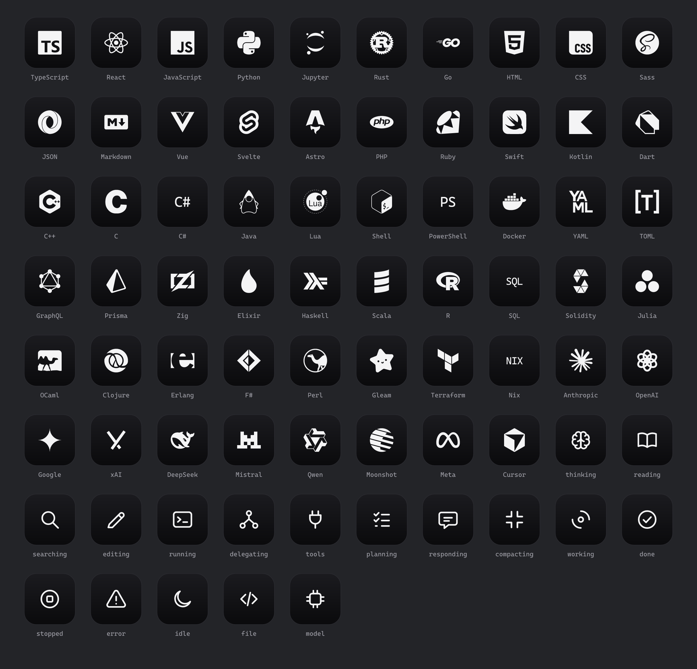

<p align="center">
  
</p>

<h1 align="center">cursor-presence</h1>

<p align="center">
  Discord Rich Presence for Cursor that follows the agent.
</p>

<p align="center">
  <a href="https://voidzxcdev.github.io/cursor-presence"><strong>Website</strong></a>
  ·
  <a href="https://github.com/voidzxcdev/cursor-presence/releases/latest">Release</a>
  ·
  <a href="#what-it-never-shows">Privacy</a>
  ·
  <a href="LICENSE">MIT</a>
</p>

<br>

<p align="center">
  
</p>

<p align="center">
  
</p>

<br>

## Install

One line in PowerShell. Paste your Discord Application ID when asked.

```powershell
irm voidzxcdev.github.io/cursor-presence/install.ps1 | iex
```

1. Create an app named **Cursor** in the [Discord Developer Portal](https://discord.com/developers/applications) and copy the **Application ID** (not a bot token).
2. Run the command above.
3. Open Cursor. The presence shows as soon as Cursor opens, before you pick a folder, and clears itself when Cursor closes.

Needs the Discord desktop app. Node.js 20+ is installed with winget if it's missing. Run the same command again to update.

<details>
<summary>Install from source</summary>

```sh
git clone https://github.com/voidzxcdev/cursor-presence
cd cursor-presence
npm install
npm run install-presence
```

</details>

## What it shows

| State | On Discord |
|:---|:---|
| **Agent** | Phase, language logo of the file it's on, model and codebase size |
| **Tab** | Language you're writing and codebase size |
| **Finished** | Cursor logo · `Last turn finished at 23:36` · `Last Codebase contains 68K chars` |
| **Open** | `In Cursor`, before a folder is open and while you are just looking |
| **Idle** | `Idle in Cursor`. The card stays up; it does not disappear |

The timer counts from when Cursor launched and never resets between cards.

## What it never shows

Project names · folder names · full paths · prompts · commands · file contents · your account.

Protected names (`.env*`, `*.key`, `*secret*`, `*token*` and similar) appear as **a protected file**.

On disk the hook keeps only a hashed chat ID, the model, the phase, a file's base name and the local project path used to count code. Everything else Cursor hands it is dropped.

## Commands

```powershell
$ctl = "$HOME\.cursor-presence\app\ctl.cjs"

node $ctl status          # what Discord currently sees
node $ctl pause           # clear until resumed
node $ctl resume
node $ctl client-id       # set or change the Application ID
node $ctl hide <folder>   # hide file names and code size here
node $ctl unhide <folder>
node $ctl restart
```

<details>
<summary>Settings · <code>~/.cursor-presence/config.json</code></summary>

<br>

| Key | Default | |
|---|---|---|
| `showModel` | `true` | Model name and provider logo |
| `showAgentFile` | `true` | File the agent is reading or editing |
| `showCodeSize` | `true` | Characters of code in the project |
| `hiddenProjects` | `[]` | Folders where file names and code size stay hidden |
| `protectedFilePatterns` | see above | File names that are never shown |
| `idleMinutes` | `5` | Minutes before the card says Idle in Cursor |
| `idleAction` | `"show"` | `"clear"` removes the presence when idle |
| `memberListShows` | `"app"` | `"activity"` puts the current action in the member list |

Changes apply within a few seconds.

</details>

<details>
<summary>How it works</summary>

<br>

Cursor runs a small hook on agent and editor events. The hook writes a few safe fields to `~/.cursor-presence/state` and nudges a background companion, starting it if needed. The companion also starts with Windows, so opening Cursor is enough: it shows `In Cursor` before a workspace is open. It counts the project's code (source files git doesn't ignore, minus lockfiles and minified bundles), builds the card and talks to Discord over its local connection, within Discord's rate limits. While you are away it keeps the card up and refreshes it. When Cursor closes, the card clears and the companion waits for the next launch.

Built and tested on Windows. The macOS and Linux paths are in place but untested.

</details>

<details>
<summary>Uninstall</summary>

<br>

```powershell
node "$HOME\.cursor-presence\app\setup.cjs" uninstall
```

Removes the hooks, the companion and its state. Your `config.json` stays.

</details>

<details>
<summary>Icon set</summary>

<br>



</details>

---

<p align="center">
  <sub>MIT · Brand icons from <a href="https://simpleicons.org">Simple Icons</a> (CC0), belonging to their owners</sub>
</p>
