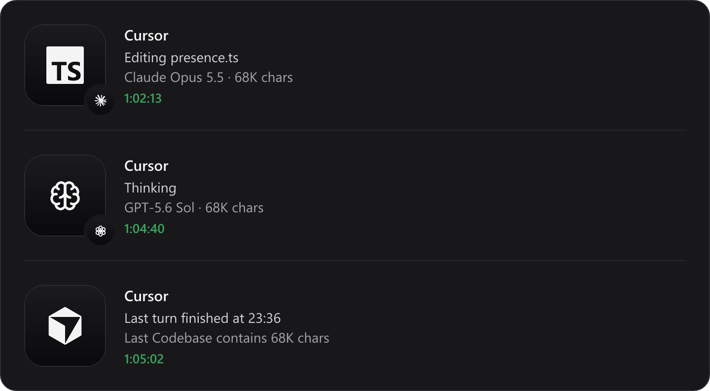

<div align="center">


# cursor-presence

Discord Rich Presence for Cursor that follows the agent, not your files.



</div>

<br>

## What it shows

| When | Card |
|---|---|
| The agent is working | What it's doing, the file's language logo, the model, and the size of the codebase |
| You're typing with Tab | The language you're writing and the size of the codebase |
| A turn just finished | The Cursor logo, when it finished and the size of the codebase, for 3 minutes |
| Nothing is happening | The Cursor logo, alone |

The timer counts from when Cursor launched and never resets between cards. The presence starts with Cursor and clears itself within seconds of Cursor closing.

## What it never shows

Project and folder names, paths, prompts, commands, file contents, and your account. File names matching `.env*`, `*.key`, `*secret*`, `*token*` and similar show as "a protected file". The hook saves only a hashed chat ID, the model, the current phase, a file's base name and the project path, which stays on your machine for counting code. Everything else Cursor hands it is dropped.

## Setup

Needs Cursor, the Discord desktop app, and Node.js 20 or newer.

1. Create an application at the [Discord Developer Portal](https://discord.com/developers/applications) and name it **Cursor**. Copy its **Application ID** from General Information. This is not a bot token, and none is needed.
2. Install:

   ```sh
   git clone https://github.com/voidzxcdev/cursor-presence
   cd cursor-presence
   npm install
   npm run install-presence
   ```

3. Paste the Application ID when asked:

   ```sh
   npm run ctl -- client-id
   ```

That's it. The installer adds its hooks to `~/.cursor/hooks.json` next to any you already have, and Cursor starts the presence the next time you open a project or a chat.

## Commands

```sh
npm run ctl -- status            # what Discord currently sees
npm run ctl -- pause             # clear the presence until resumed
npm run ctl -- resume
npm run ctl -- hide <folder>     # also hide file names and code size in this project
npm run ctl -- unhide <folder>
npm run ctl -- restart
```

## Settings

`~/.cursor-presence/config.json`

| Key | Default | |
|---|---|---|
| `showModel` | `true` | Model name and provider logo |
| `showAgentFile` | `true` | File the agent is reading or editing |
| `showCodeSize` | `true` | Characters of code in the project |
| `hiddenProjects` | `[]` | Folders where file names and code size are hidden |
| `protectedFilePatterns` | see above | File names that are never shown |
| `idleMinutes` | `5` | Minutes before the card goes back to the logo |
| `idleAction` | `"show"` | `"clear"` removes the presence when idle instead |
| `memberListShows` | `"app"` | `"activity"` puts the current action in the member list |

Changes apply within a few seconds.

## How it works

Cursor runs a small hook on agent and editor events. The hook writes a few safe fields to `~/.cursor-presence/state` and nudges a background companion, starting it if needed. The companion counts the project's code (source files git doesn't ignore, minus lockfiles and minified bundles), builds the card and talks to Discord over its local connection, within Discord's rate limits. It exits when Cursor does.

Built and tested on Windows. The macOS and Linux paths are in place but untested.

## Uninstall

```sh
npm run uninstall-presence
```

Removes the hooks, the companion and its state. Your `config.json` stays.

<details>
<summary>Icon set</summary>
<br>

</details>

<br>

MIT. Brand icons come from [Simple Icons](https://simpleicons.org) (CC0) and belong to their owners.
